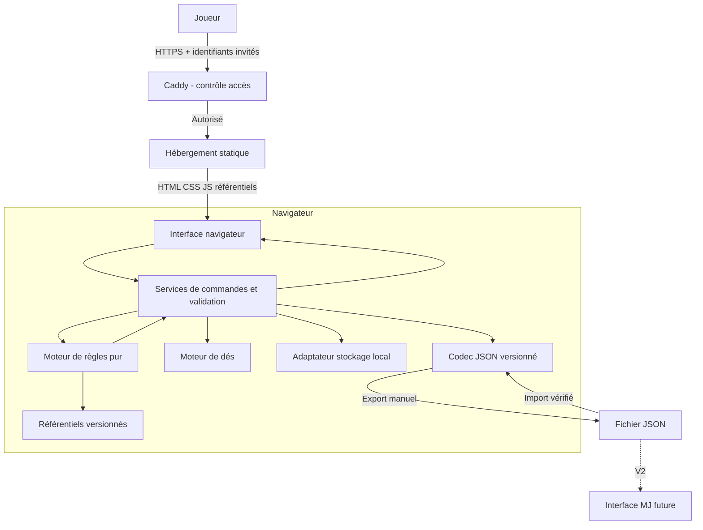
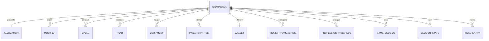

# Ulnar RPG — Architecture et décisions techniques

**Version de conception 1.0 — 25/11/2026 — soumise à approbation finale.** C = décision confirmée; P = recommandation à approuver; Q = détail technique ou métier à résoudre avant le lot concerné. Aucun code applicatif, test exécuté ni déploiement réalisé.

## 1. Principes et choix

C : V1 joueur statique, dépôt privé, accès invités, données locales et JSON; V2 import MJ, V3 API partagée. P : monolithe frontend modulaire, moteur métier pur, adaptateurs aux frontières, pas de microservices. Une seule application et un seul dépôt. Aucun backend métier ni base serveur en V1; le serveur personnel et le contrôle d’accès HTTP ne constituent pas un backend de personnage.

| Couche | Proposition | Alternative / compromis |
|---|---|---|
| UI | HTML sémantique, CSS, TypeScript DOM natif, onglets | Vue/React utiles si interactions complexes; coût de dépendances et d'apprentissage. Réévaluer si complexité réelle; ne pas anticiper V3. |
| Build | Vite, Node.js LTS supportée, npm lockfile | HTML/JS direct plus simple mais moins de vérification typée et de modularité outillée; Next/Nuxt superflus. |
| Règles | TypeScript pur, fonctions déterministes, référentiels JSON versionnés | Formules Excel dynamiques ou moteur de règles générique : risque d'injection, règles opaques et dépendances; pas d'évaluation de texte arbitraire. |
| Validation | Zod aux frontières JSON, contraintes métier distinctes | JSON Schema/Ajv : interopérabilité forte, plus de configuration; TypeScript seul ne valide pas à l'exécution. |
| Stockage | IndexedDB (P), instantanés par UUID et version précédente, transactions atomiques; multi-personnage C | LocalStorage plus simple mais synchrone et moins adapté à plusieurs fiches; SQLite/Postgres serveur hors V1. |
| Auth | Caddy HTTP Basic Auth sur HTTPS (P), comptes individuels créés sur invitation, mots de passe hachés | VPN WireGuard si groupe restreint et clients installables; OIDC/Authentik pour MFA et vraie déconnexion, mais complexité accrue. |
| Hébergement | Serveur personnel (C); Debian stable, Caddy et fichiers statiques (P), VM dédiée si possible | Nginx/Apache déjà présents : réutilisation après audit; Docker facultatif. GitHub Pages public incompatible avec confidentialité. |
| Tests | Vitest, jsdom si nécessaire, Playwright, ESLint, Prettier | Jest/Cypress possibles mais pas de bénéfice évident dans ce petit projet. |
| CI/CD | GitHub Actions, dépôt GitHub privé | GitLab CI si changement de forge; pas de Kubernetes, Docker ou Terraform obligatoires. |

Aucune API externe de jeu (Roll20, Sheets, dés, IA); seule dépendance réseau en production : hébergement et contrôle d'accès. Référentiels inclus dans build après revue des droits. Verrouiller les versions des packages au démarrage approuvé; ne pas inventer de versions actuelles.

## 2. Architecture logique et flux



Aucun appel réseau avec le contenu de la fiche. Le contrôle HTTP porte sur les ressources servies, pas sur les données locales déjà copiées. Aucun secret MJ dans les assets. Ne pas confondre rôle d'invité et rôle métier; pas de distinction de permissions entre joueurs en V1.

### Responsabilités et frontières

| Composant | Responsabilité / entrée → sortie |
|---|---|
| UI | Saisie et navigation, affichage des erreurs, valeurs dérivées et historiques; aucune formule métier dans templates. |
| Application | Orchestration : charger, valider une commande, produire nouvel état, recalculer, persister, notifier UI. Rejet sans modification si données invalides. |
| Domain/rules | Calculs caractéristiques, progression, équipement, monnaie, métiers, traits; sans DOM, stockage ni réseau. Ordre des opérations explicite, pas de double application des bonus. |
| Domain/dice | Analyse bornée d'expressions autorisées, génération uniforme et résultat détaillé; RNG injecté pour tests, Web Crypto avec échantillonnage sans biais en production. |
| Catalog | Lookup stable par identifiant, schéma de catalogue, version de règles; textes autorisés seulement. |
| Persistence | Lecture/écriture locale, erreur quota, migration de schéma, sauvegarde précédente et export. |
| Import/export | Validation runtime, contrôle version/taille, migration connue, aperçu et confirmation; sérialisation des données sources uniquement. |

Flux de modification : saisie → validation structurale → invariants métier → nouvel état → résultats dérivés → écriture locale atomique d'un instantané → rafraîchissement; en cas d'échec de persistance, état clairement marqué non sauvegardé et export proposé. Flux de jet : paramètre validé → tirage → résultat et éventuel classement validé → historique → persistance; dégâts/soins et lancement de sort via commandes séparées; effets conditionnels uniquement selon règles établies. Flux import : fichier → limites → parse sécurisé → version/migration → validation métier → aperçu → confirmation → commit; garder ancien état si échec. Les erreurs de règle non validée restent explicites, pas de calcul fictif.

## 3. Modèle de données logique (pas de BDD V1)

| Entité | Champs indicatifs / liens |
|---|---|
| Character | id stable UUID, name, level, raceId, classIds (1–2), gender, age, affiliations, deity, lore, campaignLabel, inGameSince, timestamps; avatarRef optionnel (contenu autorisé). |
| Allocation | characterId, initial[6], earlyGains[6], lateGains[6], manualBonuses/Maluses, resourceAllocations; 1:1. |
| Modifier | id, characterId, target, signedAmount, sourceType/sourceId, note; 0..n; sources et cumul à valider. |
| Spell | id, characterId, name, level, classId, category, description, diceExpression, range, extraStats, duration, manaCost, baseCost, rollType, cooldown, acquisitionHistory; 0..n. |
| Trait | id, characterId, kind(passive/psychological), origin, name, effect, acquisition (coût numérique ou note), flavorText; 0..n. |
| Equipment | id, characterId, slot, name, tier, weight, enchantments, attributes, range; un par emplacement; deux slots arme. Enchantement/attribut références catalogue + palier; custom uniquement si autorisé. |
| InventoryItem | id, characterId, category, name, quantity, value, description; 0..n. |
| Wallet | characterId, totalBronze entier sûr non négatif; 1:1; PP/PO/PA/PB dérivés selon rulesVersion; taux officiels en §9. |
| MoneyTransaction | id, characterId, deltaBronze, timestamp, note optionnelle; historique proposé, pas seconde source de vérité. |
| ProfessionProgress | id, characterId, professionId, slot, tier, xp, lastEligibleRollSessionId (nullable), examStatus; deux slots indépendants, gains au premier jet seulement, blocage au palier 6; confirmation manuelle après accord MJ. Compétences dérivées du catalogue. |
| GameSession (P) | id stable, characterId, startedAt, endedAt optionnel; session active persistée avec la fiche; le joueur ouvre explicitement une nouvelle session. |
| SessionState | characterId, sessionId, currentHp, currentMp, activeStance, turnIndex, cooldowns (spellId, remainingTurns), revision; 0..1 actif par personnage; valeurs et transitions selon matrice. |
| RollEntry | id, characterId, expression, individualDice, modifier, total, timestamp, context, outcome optionnel; 0..n. |
| RuleCatalog | rulesVersion, races, classes, professions, enchantments, attributes, thresholds; références stables; immuable pour une version publiée. |
| ExportEnvelope | schemaVersion, rulesVersion, exportedAt, character et sous-entités; pas de données secrètes ni identifiant d'accès. |

Les valeurs calculées (PV/PM max, caractéristiques, points restants, dés armure, compétences débloquées, portefeuille affiché) sont recalculées, pas des champs concurrents. C : PV/PM courants distincts des maxima; suivi cooldowns/postures et tours; P : commandes explicites, aucune avancée de tour automatique sur simple jet. Règles de changement des max et effets non définis à spécifier avant implémentation. Budget d'historique proposé 200 jets et 200 transactions; informer avant purge, export complet avant purge si nécessaire. P : taille cible 1 MiB par personnage sans images; importer au plus 1 MiB par fiche; mesurer quota et volume multi-personnage; images statiques servies séparément. Identifiants et dates au format stable, nombres entiers sûrs sauf cas métier validé; pas d'arithmétique flottante sur monnaie.



## 4. Contrats et API

V1 : pas d'endpoint REST ni de serveur fictif; routes HTTP statiques GET / et GET /assets/* seulement (éventuelle route SPA fallback selon configuration), toutes soumises à authentification HTTP. Pas d'URL de mutation. Contrats applicatifs conceptuels, sans implémentation :

| Opération | Entrée | Sortie / erreur |
|---|---|---|
| listCharacters / loadCharacter | aucun / UUID | liste résumée / snapshot valide ou absence; erreur stockage/version |
| createCharacter / selectCharacter / deleteCharacter | données initiales / UUID / UUID + confirmation | état isolé, sélection ou suppression explicite; aucun effet sur les autres fiches |
| applyCommand | état + commande typée (édition, équipement, allocation, transaction, examen) | nouvel état + résultats dérivés, ou erreurs de champ/invariant sans mutation |
| applySessionAction | UUID + action (dégât, soin, mana, sort, tour, posture), révision attendue | état courant + historique atomiques; erreur métier sans mutation |
| calculateCharacter | sources + rulesVersion | derivedStats + diagnostics |
| rollDice | expression autorisée + contexte | individualDice, total, outcome si validé; INVALID_EXPRESSION |
| exportCharacter | snapshot validé | enveloppe JSON UTF-8 versionnée |
| previewImport / confirmImport | fichier JSON / aperçu confirmé | diff + erreurs / nouveau snapshot; UNSUPPORTED_VERSION, INVALID_DATA, STORAGE_ERROR |

Contrats JSON : champs obligatoires, bornes, enums, relations et migrations documentés avant développement; versions incompatibles refusées; aucun silencieux remplacement de règles. V2 : lecteur du même format, aucun réseau obligatoire.

V3 (indicatif, pas engagé) : API HTTPS JSON versionnée `/api/v1`; GET/POST `/characters`, GET/PATCH `/characters/{id}`, POST `/characters/{id}/rolls`, GET `/campaigns/{id}/characters`. Auth session/OIDC, vérification d'appartenance et droits par objet côté serveur, version optimiste/If-Match, erreurs 400/401/403/404/409/422, pagination si nécessaire; schémas OpenAPI avant codage. PostgreSQL relationnel possible (User, Campaign, Membership, Character et tables ci-dessus), FK, contraintes, audit et migration. Le serveur devient source d'autorité; ne jamais faire confiance aux totaux envoyés par le client. Pas de promesse de sécurité des jets V1.

## 5. Arborescence proposée du dépôt

`ulnar-rpg/` (privé, créé par le porteur) :

```text
PRD.md
ARCHITECTURE.md
TESTING.md
DEVOPS.md
ROADMAP.md
README.md                       (phase 1)
docs/
  rules/                        matrice sources, arbitrages et fixtures autorisées
  adr/                          décisions validées
src/
  domain/                       calculs, types, dés, invariants
  application/                  commandes, état et services
  catalog/                      référentiels versionnés
  infrastructure/               stockage, codec, migrations
  ui/                           vues, navigation, composants
  styles/
  main.ts                       point d'entrée futur
public/                         assets autorisés uniquement
tests/
  unit/
  integration/
  e2e/
  fixtures/                     personnages fictifs/validés anonymisés
.github/workflows/              CI, staging, production
index.html
package.json / package-lock.json
vite.config.ts / tsconfig.json
deploy/                         documentation Caddy/systemd et procédure de livraison (future, sans secret)
```

Aucun de ces fichiers de code/configuration n'est créé maintenant. Le classeur original n'est pas placé dans public ni dans les artefacts; stockage privé de référence autorisé uniquement.

## 6. Performance, évolution et limites

Recalcul local pur sur changement, pas de polling. Référentiels indexés par id; éviter re-render global si mesure problématique. Chargement différé des images éventuelles; aucune image lourde dans les instantanés. Cibles N01–N03 du PRD; mesurer avant optimisation. Chaque joueur utilise son navigateur : absence de contention serveur de données. La taille des états, quota IndexedDB et changements d'origine sont les vraies limites. Pas de PWA/service worker en V1 par défaut (caches et confidentialité); pas de disponibilité hors ligne garantie. Export manuel nécessaire pour changement d'appareil, perte de navigateur, migration d'origine.

## 7. Sécurité d'architecture

Caddy authentification obligatoire sur toutes les routes et assets; comptes nominatifs hachés hors dépôt, révocation par retrait du compte et rechargement contrôlé; MFA GitHub administrateur, SSH via réseau de gestion. HTTP Basic ne fournit ni MFA ni déconnexion fiable; accès à renforcer via OIDC/VPN si requis; ne pas utiliser URL secrète ou mot de passe JS. Activer HTTPS, CSP restrictive adaptée (scripts/style self, pas d'eval ni inline non autorisé), nosniff, frame-ancestors none, Referrer-Policy restrictive. Valider imports, limites de tailles et collections; afficher contenu comme texte, ne pas injecter HTML, bloquer URL javascript/data non autorisées; pas de fusion d'objets non contrôlée. Rejeter expressions de dés non conformes, plafonner tirages/faces/longueur, pas d'eval. Ne pas stocker de secrets, emails invités, jetons ou données MJ dans le bundle. IndexedDB n'isole pas les personnes utilisant le même profil, ne chiffre pas et est modifiable; déconnexion ne supprime pas les copies locales. Aucun anti-triche en V1. Si confidentialité entre joueurs, ordinateurs partagés ou données serveur requises, revoir l'architecture.

## 8. Références techniques et choix à approuver

- Caddy Basic Auth : https://caddyserver.com/docs/caddyfile/directives/basic_auth
- Caddy HTTPS : https://caddyserver.com/docs/automatic-https
- IndexedDB : https://developer.mozilla.org/fr/docs/Web/API/IndexedDB_API/Using_IndexedDB
- GitHub Release assets : https://docs.github.com/en/rest/releases/assets

P : un stockage IndexedDB avec stores `characters` (UUID, snapshot, revision), `previousSnapshots` (UUID, sauvegarde précédente) et `settings` (activeCharacterId). Toutes les sous-entités du diagramme appartiennent au snapshot de leur personnage, pas à des tables SQL; sauvegarde atomique du snapshot et du précédent. Révision comparée dans une transaction readwrite pour refuser l'écrasement par un autre onglet. Import avec UUID existant : choix explicite remplacement ou copie à nouvel UUID, jamais fusion silencieuse. Chaque origine navigateur est isolée; un même profil partagé n'isole pas les comptes HTTP. Déploiement privé fictif et validation réseau avant diffusion.

## 9. Contrats métier banque et métiers — V1.0

Banque (C) : valeur entière sûre et non négative en PB; taux versionnés PP=100 000 PB, PO=100 PB, PA=10 PB. La commande de transaction accepte des variations signées. Vérifier dépassement et solde final avant toute mutation; un résultat négatif donne INSUFFICIENT_FUNDS. Normaliser par divisions entières, sans flottants. P : rejeter les saisies invalides/décimales, accepter un champ vide comme zéro; horodatage et historique. Le script historique lit les indices 0,2,4,6 de I:P et applique d’autres taux : ne pas reproduire ses coordonnées ni ses taux. Ne jamais convertir silencieusement les exports d’une autre version de règles.

Métiers (C) : enregistrer le premier jet de chaque métier par session; XP 4/2/1/0 selon résultat décrit dans la fiche; gains bloqués au palier 6. Confirmation d’examen manuelle après accord du MJ, seuil atteint et palier < 6; montée unique et surplus conservé. Aucun débit automatique. P : une commande d’ouverture de session crée un identifiant stable; chaque slot conserve l’identifiant du dernier premier jet traité, même si XP=0. L’état de session et le marqueur doivent survivre au rechargement et à l’export/import. Les jets suivants restent possibles, sans gain XP. C : étude hors V1. Q : correction d’un jet et modalités de changement de session. Ne pas automatiser ces exceptions sans validation. Le contrôle local ne constitue pas une preuve d’accord du MJ et ne garantit pas l’absence de triche.

## 10. Gestion de session et fidélité stricte (V1)

Le moteur réplique les expressions Excel avec références et arrondis tels quels, y compris les dépendances surprenantes. Les arbitrages banque/métiers les remplacent uniquement là où ils s’appliquent. Les fonctions Google Sheets encapsulées nécessitent une référence exécutable ou des cas entrée/sortie fiables; aucun cache constant ne remplace un calcul. Les textes d’effets restent affichés si leur mécanique n’est pas spécifiée.

P : un état de session par personnage, actions explicites pour dégâts/soins, dépense de PM, lancement de sort, passage de tour, changement de posture. Un sort ne doit pas débiter deux fois ni créer un cooldown sur une action refusée; appliquer et sauvegarder atomiquement. Les règles de bornage, déclenchement et durée ne sont pas inventées. Avant ce lot, établir la matrice de transitions (préconditions, effets, erreur, test) avec les sources et le MJ; les règles non définies sont bloquantes pour leur automatisation.
