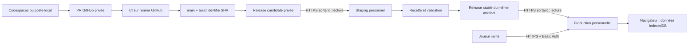

# Ulnar RPG — DevOps, infrastructure et CI/CD

**Version de conception 1.0 — 25/11/2026 — soumise à approbation finale.** C = confirmé; P = proposition; Q = détail à résoudre. Dépôt privé créé d’après la capture; aucun workflow, serveur ni déploiement vérifié.

## 1. Infrastructure cible

C : dépôt GitHub privé `Shiro-rpg/ulnar-rpg`, serveur personnel, site réservé aux invités. P : Debian stable sur VM dédiée ou environnement isolé, Caddy comme serveur statique et terminaison HTTPS, comptes nominatifs HTTP Basic Auth, accès SSH via réseau de gestion uniquement. Réutiliser un reverse proxy existant s'il peut assurer les mêmes garanties; aucune obligation Docker, Kubernetes ou cloud payant. Pas de backend métier, ni de BDD serveur. Les personnages restent dans IndexedDB côté navigateur.

| Dimension | Proposition initiale / vérification |
|---|---|
| Ressources | 1 vCPU, 512 MiB–1 GiB RAM, 10 GiB disque disponibles pour site et releases; dimensionnement indicatif à mesurer, pas de réservation constatée |
| DNS/TLS | Deux noms stables staging/prod, certificat valide, redirection HTTP vers HTTPS sans contenu; tester renouvellement |
| Réseau | Si Internet direct : vérifier IP publique, CGNAT, DNS, NAT, ouvrir seulement ports nécessaires au HTTPS/ACME; SSH non public. Alternative VPN pour invités si accès direct impossible ou non souhaité. |
| Isolation | Compte de service Caddy lecture seule des fichiers; compte de déploiement limité aux releases; séparer de tout service professionnel et réseau interne sensible |
| Coût | Réutilisation du serveur possible, coût marginal électricité/domaine/sauvegardes et quotas GitHub à établir. Aucun montant garanti. |

Q P1 : machine disponible, OS/version, domaine, IP et accès public/VPN, reverse proxy existant, capacité de sauvegarde, nombre de joueurs et politique d’accès. Ne pas déployer de contenu Ulnar tant que le test fictif ne prouve pas l'absence de contournement. Si le serveur héberge déjà des services, privilégier séparation réseau et environnement isolé; pas de modification de leur configuration sans accord.

## 2. Git et gouvernance

Branche `main` stable; `docs/project-planning`, `feature/<ticket>`, `fix/<ticket>` courtes. PR avec objectif, preuves tests, impact règles/migrations, critères de recette et rollback. Squash merge proposé; tags SemVer `v1.0.0`; versions de schéma et règles séparées. Protection main, checks requis, relecture et interdiction force-push si plan GitHub compatible; sinon procédure manuelle documentée sans prétendre à un contrôle automatique. MFA des mainteneurs GitHub; joueurs non collaborateurs du dépôt. Issues/milestones sans fiches personnelles. Au minimum revue métier des changements de règles et revue sécurité pour accès/déploiement.

## 3. Environnements

| Environnement | Accès et données | Déploiement |
|---|---|---|
| Dev | Codespaces ou poste local, Vite, fixtures fictives; aucun secret prod | Local |
| CI | Runner GitHub éphémère; fixtures minimisées | PR et main |
| Staging | Origine, compte de service, identifiants et répertoire distincts; testeurs seulement | Automatique après main et CI, candidate privée |
| Prod | Origine stable, joueurs invités uniquement, assets autorisés | Promotion explicite du même artefact vérifié |

Pas de preview publique. Staging et prod peuvent partager la VM si isolés par comptes, répertoires, hôtes et droits, mais pas leur origine web. Les données navigateur sont isolées par origine; une migration d'URL exige export/import. Pas de vraies fiches en staging. Toutes les routes HTML/JS/JSON/images sont protégées. Aucun accès direct aux releases, fichiers de config, archives, sauvegardes ou autres ports. L'authentification est séparée de l'artefact et reste en vigueur lors d'un rollback.

## 4. CI/CD (proposition à approuver)

Principe pull : le serveur récupère les artefacts privés via HTTPS sortant, sans ouvrir SSH à GitHub ni installer un runner général sur le serveur. Un service et timer systemd restreints par environnement récupèrent les releases admissibles. Un token GitHub à granularité fine limité au dépôt, permission Contents read, réside uniquement sur le serveur; aucune exécution de scripts issus de l'archive. Le déploiement initial peut être manuel avec la même procédure avant d'automatiser.

| Étape | Déclenchement / condition |
|---|---|
| CI PR | checkout, Node LTS supportée verrouillée, npm ci, format, lint, typecheck strict, Vitest/couverture, build Vite, Playwright, scans; aucune credential de prod |
| CI main | mêmes vérifications, archive dist + manifest version app/règles/schéma/SHA, SHA-256 et rapport; contrôler absence de secrets, fixtures, classeurs, fichiers non autorisés et sourcemaps publiques |
| CD staging | workflow main publie candidate privée identifiée par SHA/tag distinct; service staging récupère uniquement cette catégorie et vérifie archive/checksum avant activation |
| Validation | smoke anonyme (refus) et authentifié, vérification SHA, recette; approval GitHub environment si disponible, sinon workflow_dispatch réservé et revue documentée |
| CD prod | workflow de promotion référence le même artefact vérifié, sans rebuild, publie release stable versionnée avec manifeste et checksum identiques; serveur prod accepte uniquement releases stables approuvées |
| Après activation | smoke positif/négatif et version; si échec revenir à la release précédente, alerter et suspendre l'adoption de la release échouée |

Le mécanisme de sélection distingue strictement candidates et stables; tag/manifest SHA validés et contrôles de version empêchent d'installer une candidate en prod. Verrou local par environnement; rejeter les archives trop grandes, chemins absolus, traversée de répertoires, symlinks et fichiers hors allowlist. Extraire dans un nouveau répertoire privé, vérifier puis basculer atomiquement le lien `current` dans le même système de fichiers; conserver trois versions et nettoyer seulement après succès. Rollback manuel épingle la version précédente et suspend le timer ou sa promotion jusqu'à décision. Les fichiers de config/auth ne font jamais partie de dist. Le checksum protège des corruptions et erreurs de livraison, pas d'un compte GitHub compromis; contrôler droits release et provenance du commit.

Permissions : CI lecture dépôt; job de publication seul reçoit Contents write; tokens de déploiement serveur lecture uniquement et distincts si possible; pas de secrets dans forks/PR, pas de pull_request_target exécutant du code non fiable; Actions épinglées SHA, cache npm lockfile; concurrence GitHub et serveur; délai cible CI ≤10 min (P). Quotas et permission d'approval à vérifier selon plan. Alternative : SSH via VPN ou tunnel de gestion si pull non faisable, après approbation; éviter runner auto-hébergé exécutant des PR non fiables.

## 5. Authentification, secrets et sécurité

C : invitation obligatoire. P : Caddy Basic Auth par compte individuel, mot de passe robuste haché avec algorithme supporté, distribution initiale via canal privé, rotation et suppression au retrait. Basic Auth est simple et sans compte applicatif, mais ne fournit pas de MFA ni déconnexion fiable; le navigateur peut garder les identifiants en mémoire. Révocation protège les nouvelles requêtes, pas les fichiers déjà reçus ni les données locales; pas d'isolation des personnages entre comptes sur un profil partagé. Si ces limites sont inacceptables, utiliser IdP OIDC ou VPN à valider avant production. Sur Internet : TLS obligatoire, limiter tentatives (pare-feu/outil de limitation adapté), tester protection brute force et surveiller abus; refuser par défaut. Ne jamais publier une URL non authentifiée.

| Secret/configuration | Emplacement |
|---|---|
| Hash des comptes invités | Fichier/config Caddy hors racine web, permissions restreintes, sauvegarde chiffrée |
| Token lecture releases | Credential systemd ou fichier protégé du compte de déploiement; rotation/révocation; pas de log ni dépôt |
| Compte smoke staging | Credential dédié restreint, jamais en clair dans rapports |
| Clés TLS / SSH | Stockage système protégé; accès admin séparé |
| Hostnames / version | Configuration non sensible versionnée |
| VITE_* | Publiques dans le bundle : aucun secret |

CSP restrictive, nosniff, frame-ancestors none, Referrer-Policy, contrôle du cache privé (no-store pour contenu protégé recommandé), pas de listing ni d'assets tiers non approuvés. Pas de source maps publiques. Vérifier config avant reload; vérifier directement HTML et assets, variantes Host et chemin, anciens répertoires, ports et URL alternative. MFA administrateur GitHub, accès SSH par clés via gestion, patchs OS et Caddy, scans des dépendances et secrets. En cas de fuite : suspendre service si nécessaire, révoquer/rotation, analyser historique et logs; copies déjà reçues non récupérables.

## 6. Logs et supervision

GitHub Actions : commit/tag, durée, résultats, erreurs; aucun contenu joueur. Serveur : journald Caddy/service de déploiement, disponibilité, HTTP 401/5xx, espace disque, expiration TLS, statut et SHA déployé, CPU/RAM. Logs d'accès minimisés, sans Authorization ni query sensible, droits restreints, rotation et rétention 30 jours proposées. Zéro journal central des jets/fiches. Smoke externe ou depuis réseau invité : refus sans identifiant et réponse valide avec compte dédié; un 401 seul ne prouve pas fonctionnement. Alertes échec CI/deploy, indisponibilité et disque (seuil initial 80 % P). Monitoring léger d'abord, réutilisation supervision personnelle possible si elle existe et si isolée. Diagnostic utilisateur volontaire et anonymisé.

## 7. Sauvegardes et rollback

| Donnée | Politique proposée |
|---|---|
| Git/source | Clone privé de secours, tags, vérification restauration |
| Builds | Au moins trois dernières releases prod avec SHA et métadonnées, copie privée hors serveur |
| Serveur | Sauvegarde config, comptes hachés, unités de déploiement et procédure réseau, chiffrée hors machine; secrets réémis si incident |
| Personnages | IndexedDB autosave + précédent par personnage; export JSON en fin de session et avant mise à jour; copie hors navigateur |

RPO joueur = dernier export disponible (aucune sauvegarde serveur de fiche). RTO joueur cible ≤5 min avec export valide; RTO site ≤30 min pendant intervention mainteneur (P, pas SLA). Sauvegarde serveur après changement config et périodique au moins hebdomadaire (P); vérifier restauration avant mise en production. Rollback : suspendre pull, identifier release antérieure vérifiée, vérifier compatibilité schéma, basculer current, vérifier auth et smoke, journaliser et décider reprise. Une version ancienne incompatible avec IndexedDB ne doit jamais écraser les fiches; prévoir export avant migration, migration non destructive, ou correctif forward. En cas de perte totale : restaurer configuration et release depuis copie privée, réémettre secrets, vérifier accès avant ouverture.

## 8. Références et portes

- https://caddyserver.com/docs/caddyfile/directives/basic_auth
- https://caddyserver.com/docs/automatic-https
- https://docs.github.com/en/rest/releases/assets
- https://docs.github.com/en/rest/releases/releases

Avant diffusion : validation machine/réseau/DNS/TLS et méthode d'accès, permissions GitHub, déploiement pull fictif et rollback, protection de toutes les ressources. Aucun serveur, secret ou workflow n'a été modifié ou créé dans ce cadrage.
